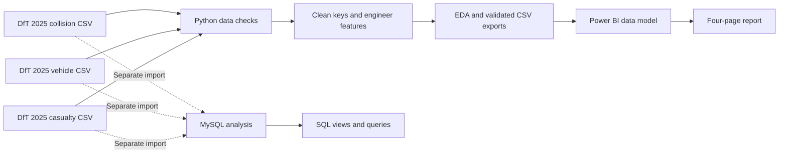

<div align="center">

# 🚦 UK Road Safety Intelligence | 2025

### From raw collision records to actionable analytical insights

**An end-to-end data analytics portfolio project built with Python · MySQL · Power BI**

   

**[📊 Explore dashboards](#-power-bi-dashboard-tour)** · **[🔎 See findings](#-key-findings)** · **[🧪 Explore methodology](#-how-the-project-works)** · **[▶️ Get started](#%EF%B8%8F-how-to-explore-this-project)**

</div>

---

## 🎯 The question

**What do Great Britain's 2025 reported injury-collision records reveal about collision severity, road conditions, road users, time of day, and geographical distribution?**

This project combines three related datasets—**collisions**, **vehicles**, and **casualties**—to build a reproducible Python analysis, practise relational querying in MySQL, and communicate patterns through a four-page Power BI report.

> [!IMPORTANT]
> **How to interpret these figures:** This is an analysis of *reported injury collisions*, not a calculation of collision risk per journey or vehicle-mile. Differences in traffic exposure, road usage, reporting, and population may explain some of the observed patterns.

## 📈 Project at a glance

| 🚘 Reported injury collisions | 🚗 Vehicle records | 🧍 Casualty records | ⚠️ KSI collisions | 📉 KSI share |
|:---:|:---:|:---:|:---:|:---:|
| **101,525** | **183,948** | **127,883** | **26,644** | **26.24%** |

*KSI collisions are those recorded with fatal or serious collision severity; the count is not the number of people killed or seriously injured.*

## 🧭 Explore this repository

| Destination | What you'll find |
|---|---|
| [🐍 Python notebooks](notebooks/) | Inspection, cleaning, feature engineering, merging, and exploratory visualisation |
| [🗄️ SQL analysis](sql/) | SQL examples and import notes; add the original executed Workbench scripts before presenting them as final work |
| [📊 Power BI report](powerbi/UK_Road_Safety_Intelligence_2025.pbix) | Four-page interactive `.pbix` report for Power BI Desktop |
| [🖼️ Dashboard screenshots](screenshots/) | Add exported screenshots of each page for browser-friendly previews |
| [🗂️ Data guidance](data/README.md) | Dataset sources and how to obtain the data |
| [⚙️ Dependencies](requirements.txt) | Python libraries used |

---

## 🖥️ Power BI dashboard tour

The report is saved in **[`powerbi/UK_Road_Safety_Intelligence_2025.pbix`](powerbi/UK_Road_Safety_Intelligence_2025.pbix)**. Open it in **Power BI Desktop** to interact with slicers and visuals.

<details open>
<summary><b>01 · UK Road Safety Overview</b> — the national picture</summary>

<br>

- Five KPI cards: collisions, vehicles, casualties, KSI collisions, and KSI rate
- Collision severity and KSI percentage by posted speed limit
- Hourly collision pattern and speed-limit filtering

**What to look for:** 30 mph roads have the largest recorded collision count, while 60 mph roads have the highest KSI *proportion* among the reported speed-limit groups.

<!-- When screenshots/01_overview.png exists, uncomment the next line. -->
<!--  -->

</details>

<details>
<summary><b>02 · Casualty & Vehicle Analysis</b> — the people and vehicles involved</summary>

<br>

- Casualty severity and age-band distributions
- Vehicle-type composition and casualties by speed-limit group
- Linked visuals across the collision, casualty, and vehicle tables

**What to look for:** Slight injuries are the most frequently recorded casualty severity. Some category labels use STATS19 codes; consult the official data guide before interpreting them.

<!--  -->

</details>

<details>
<summary><b>03 · Road Conditions & Geography</b> — environment and location</summary>

<br>

- Collision counts by road class, weather condition, and lighting condition
- Azure Maps visual showing recorded collision locations
- Geographic concentration **does not establish exposure-adjusted road danger**

**What to look for:** Road-class code 3 has the largest collision count (43,827). Weather and lighting variables are recorded as STATS19 codes.

<!--  -->

</details>

<details>
<summary><b>04 · Key Findings & Conclusions</b> — executive summary</summary>

<br>

- Main descriptive findings from the dashboards
- Practical interpretations, data caveats, and analytical limitations
- A stakeholder-friendly summary for readers who don't need the implementation details

<!--  -->

</details>

> **Want dashboard previews directly on GitHub?** Export each Power BI report page as a PNG, add it to `screenshots/`, and uncomment the corresponding Markdown image line above. GitHub will then show the screenshots inside these expandable sections.

## 🔎 Key findings

| Analytical question | Finding | Interpretation |
|---|---|---|
| Which speed-limit group recorded the most collisions? | **30 mph — 49,673** | Highest *count*, not necessarily highest risk |
| Which speed-limit group had the largest KSI share? | **60 mph — 36.38%** | A larger proportion of recorded collisions were fatal or serious |
| At what hour were collisions most frequent? | **17:00 (5 PM)** | A peak in recorded frequency, not an exposure-adjusted rate |
| Which casualty severity was most common? | **Slight — 98,587** | Compared with 27,758 serious and 1,538 fatal casualties |
| Which road-class category had the most collisions? | **Code 3 — 43,827** | Refer to the DfT codebook for the road-class category definition |

<details>
<summary><b>📘 A closer look at collision severity</b></summary>

<br>

| Collision severity | Recorded collisions |
|---|---:|
| Fatal | 1,453 |
| Serious | 25,191 |
| Slight | 74,881 |
| **Total** | **101,525** |

The **26,644 KSI collisions** are `1,453 + 25,191`. Collision severity and casualty severity are different measurements; avoid treating their totals as interchangeable.

</details>

---

## 🧪 How the project works



**The Power BI dataset comes from the complete Python-prepared CSV extracts—not from the MySQL tables.** The MySQL branch is a separate analytical exercise with documented import shortfalls.

<details>
<summary><b>🐍 Stage 1 — Python: data quality, joins and exploratory analysis</b></summary>

<br>

- Inspect missing values, record counts, identifier quality, and duplicates.
- Standardise `join_ref` to join collisions to their associated vehicles/casualties.
- Validate expected one-to-many relationships before aggregation.
- Engineer KSI/severity and hourly features; inspect variation by speed limit, road class, and time.
- Retain the two collisions missing geographic coordinates for non-map analysis.

**Notebooks (run sequentially):**
1. [`01_data_inspection_cleaning.ipynb`](notebooks/01_data_inspection_cleaning.ipynb)
2. [`02_feature_engineering_merging.ipynb`](notebooks/02_feature_engineering_merging.ipynb)
3. [`03_visualisation_insights.ipynb`](notebooks/03_visualisation_insights.ipynb)

The notebook cells were separated from an original sequential notebook without changing their code. **Later notebooks depend on variables from earlier cells; they are not guaranteed to run as standalone notebooks.** Adjust local data paths as needed.

</details>

<details>
<summary><b>🗄️ Stage 2 — MySQL: relational analysis and reporting</b></summary>

<br>

Techniques practised include `JOIN`, `GROUP BY`, `CASE`, CTEs, window functions (`ROW_NUMBER`, `RANK`, `DENSE_RANK`), and reporting views:

- `vw_speed_limit_analysis`
- `vw_collision_severity`
- `vw_road_class_summary`

The repository's example queries are **illustrative**, not a substitute for the original executed SQL Workbench scripts. See [`sql/README.md`](sql/README.md) for the import caveat.

</details>

<details>
<summary><b>📊 Stage 3 — Power BI: modelling and stakeholder reporting</b></summary>

<br>

- Load complete Python-derived CSVs into Power Query.
- Relate `collisions_2025[join_ref]` one-to-many to the vehicle and casualty tables.
- Create DAX measures for counts and KSI percentage.
- Build four report pages with filters, comparative charts, geographic analysis, and findings.

```dax
KSI Collisions =
CALCULATE(
    COUNTROWS(collisions_2025),
    collisions_2025[collision_severity] IN {1, 2}
)
```

</details>

## ⚠️ Data reconciliation: an important limitation

The separate MySQL CSV import did **not** load all source rows. Power BI uses the *complete Python-prepared data*, so its headline results should not be represented as reconciled to the SQL import.

| Table | Python / Power BI rows | MySQL imported rows | Rows missing in MySQL |
|---|---:|---:|---:|
| Collisions | 101,525 | 101,523 | 2 |
| Vehicles | 183,948 | 179,705 | 4,243 |
| Casualties | 127,883 | 124,769 | 3,114 |

**Next improvement:** Re-import the MySQL tables using a validated bulk-loading process, re-check all three row counts, and rerun SQL-to-Python reconciliation queries. Until then, treat SQL results as an independently explored subset.

## ▶️ How to explore this project

<details open>
<summary><b>Option A — Explore the dashboard (fastest)</b></summary>

<br>

1. Download [`UK_Road_Safety_Intelligence_2025.pbix`](powerbi/UK_Road_Safety_Intelligence_2025.pbix).
2. Open it in **Power BI Desktop**.
3. If prompted about unavailable local CSV paths, point each imported table to your local prepared CSV via **Transform data → Data source settings**.
4. Use the page navigation, bar charts, slicer, and map to explore the visuals.

> The source CSVs are not distributed in this repository. Some data-source refresh and map functions can depend on local files and Power BI settings.

</details>

<details>
<summary><b>Option B — Examine the Python analysis</b></summary>

<br>

1. Obtain the collision, vehicle, and casualty files from the [UK Department for Transport road safety datasets](https://www.gov.uk/government/statistical-data-sets/ras30-reported-casualties-in-road-accidents).
2. Install the dependencies:

   ```bash
   python -m pip install -r requirements.txt
   ```

3. Open Jupyter in the repository folder:

   ```bash
   jupyter notebook
   ```

4. Open the notebooks in numbered order using a shared kernel, adjusting CSV paths to your download location.

</details>

<details>
<summary><b>Option C — Review the SQL work</b></summary>

<br>

Explore [`sql/`](sql/) to review the query examples and import notes. The original executed Workbench queries should be added here separately when available. Validate row counts before comparing SQL results with the complete Python/Power BI figures.

</details>

## 📁 Folder structure

```text
uk-road-safety-intelligence-2025/
├── notebooks/
│   ├── 01_data_inspection_cleaning.ipynb
│   ├── 02_feature_engineering_merging.ipynb
│   └── 03_visualisation_insights.ipynb
├── sql/
│   ├── example_analysis_queries.sql
│   └── README.md
├── powerbi/
│   └── UK_Road_Safety_Intelligence_2025.pbix
├── screenshots/              # Add 4 dashboard exports here
├── data/
│   └── README.md
├── requirements.txt
├── .gitignore
└── README.md
```

## 📚 Data source, definitions and scope

- **Source:** UK Department for Transport (DfT), [reported road casualties in Great Britain — open data](https://www.gov.uk/government/statistical-data-sets/ras30-reported-casualties-in-road-accidents).
- **Scope:** 2025 reported injury-collision, vehicle, and casualty records from the available extract.
- **Severity:** Collision severity and casualty severity are related but distinct.
- **Coding:** Weather, lighting, vehicle type, age band, and road class may use numeric STATS19 categories; consult the relevant DfT data guide for mappings.
- **Analysis limits:** These are descriptive associations. No causal inference, road-exposure adjustment, or verified predictive claim is made.

## 👤 About this project

Created as an independent data analytics portfolio project by an **MSc Data Science and Artificial Intelligence student at the University of Liverpool**, combining hands-on Python, SQL, and Power BI to move from data validation to clear reporting.

<div align="center">

**⭐ If this project was useful, consider starring the repository.**

[⬆ Back to top](#-uk-road-safety-intelligence--2025)

</div>
